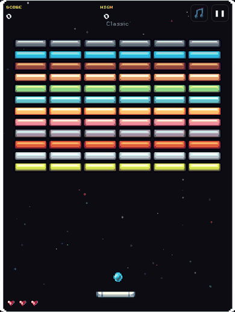
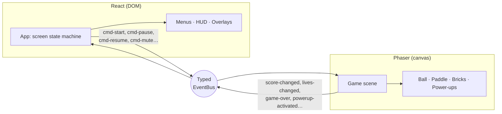

# ZeroZero

[](https://github.com/pgraca97/zerozero-v2/actions/workflows/ci.yml)

A retro brick-breaker for the browser, built as a production-style web app: React UI over a Phaser game canvas, typed end to end, tested in CI and deployed on every push.

### ▶ [Play it live](https://zerozero-v2.paulodcgraca.workers.dev)

<p align="center">
  
</p>

## Features

- **3 data-driven levels**: a level is a list of row-strings plus a legend, so adding one is a single entry
- **12 power-ups** (multiball, magnet, bullets, inverted controls…) with a weighted drop table and one timed effect at a time
- **Hand-tuned paddle physics**: the bounce angle comes from where the ball hits and how fast the paddle is moving, not plain reflection
- **Keyboard, mouse and touch** input; pause, mute, level select, persistent high score
- **Accessible UI**: menus and HUD are real DOM, and game events are announced through an ARIA live region

## Tech stack

| Layer | Tools |
|---|---|
| UI | React 19, TypeScript, CSS |
| Game engine | Phaser 4 (Arcade physics, 120 Hz step) |
| Build | Vite, pnpm workspaces, Turborepo |
| Testing | Playwright end-to-end tests |
| CI/CD | GitHub Actions (typecheck → build → e2e); Cloudflare Workers deploy on push, preview URL per branch |
| Backend *(next)* | Supabase: Postgres, Row Level Security, auth, Edge Functions |

## Architecture

React and Phaser never import each other. Everything crosses one typed event bus: the game emits **state**, and the UI sends **commands**.



The game runs at a fixed virtual resolution (480×640) and Phaser scales it to fit, so all gameplay values are authored in one coordinate space and there is no scale-factor math.

## Technical decisions

- **React for the UI, Phaser for the game only.** Text, buttons and overlays stay accessible and easy to style as DOM, and Phaser does what it is good at: physics and rendering at 120 Hz. Keeping a typed event contract between them makes each side testable and replaceable.
- **Phaser is lazy-loaded.** It is about 88% of the JavaScript. A static import kept the page blank until all 1.9 MB had downloaded. Now the entry chunk is 212 kB (67 kB gzip), React paints the loading screen at once, and `modulepreload` hints fetch Phaser in parallel. On a throttled connection (1.6 Mbps, 150 ms RTT; median of 5 interleaved runs), **first paint dropped from 2.7 s to 1.3 s** and time to a playable menu stayed the same (4.6 → 4.7 s). Lazy-loading without the preload painted even sooner (0.8 s) but made the menu 0.5 s slower, so the preload variant shipped.
- **Monorepo from day one.** `apps/web` is the game; the upcoming backend (Supabase migrations, shared types) gets its own package without restructuring.
- **Cloudflare Workers static assets** for hosting: free global CDN, automatic deploys from `main` and a preview URL for every branch.

## Project structure

```
apps/web/            the game — React UI + Phaser canvas
  src/game/          Phaser scenes, game objects, level + power-up data, EventBus
  src/ui/            React screens and components
  tests/             Playwright e2e specs
packages/tsconfig/   shared TypeScript presets
docs/                design notes (backend plan)
```

## Running locally

Requires Node 24 and pnpm.

```bash
pnpm install
pnpm dev      # http://localhost:5173
pnpm check    # typecheck + build + e2e tests (same gate as CI)
```

## Roadmap

- [x] Migrate from p5.js to React + Phaser + TypeScript
- [x] Monorepo, CI, Cloudflare deploy
- [x] Lazy-load Phaser for a faster first paint
- [ ] Global leaderboard (Supabase + Row Level Security)
- [ ] Server-side score validation to block cheating (Edge Function)
- [ ] Accounts and personal stats
- [ ] Level editor with shareable levels

---

The first version (static, GitHub Pages) is frozen at [pgraca97/zerozero](https://github.com/pgraca97/zerozero), playable at [pgraca97.github.io/zerozero](https://pgraca97.github.io/zerozero/).
